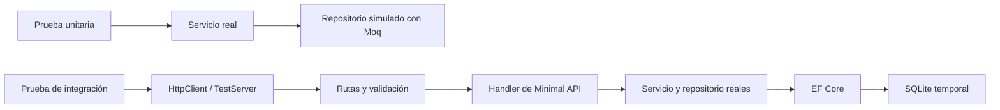

# Pruebas unitarias y de integración

Ejemplo con Minimal API en .NET 10 que calcula una cotización de productos. Incluye comentarios en el código y dos proyectos de pruebas: **xUnit + Moq** para aislar las reglas del servicio y **xUnit + Microsoft.AspNetCore.Mvc.Testing** para comprobar el flujo HTTP de ASP.NET Core.

La aplicación consulta **PostgreSQL mediante EF Core y Npgsql**. Las pruebas de integración sustituyen ese proveedor por **SQLite en memoria**, manteniendo el endpoint, el servicio y el repositorio reales. Las unitarias siguen usando Moq.

## Ejecutar las pruebas

Desde la raíz del repositorio, con .NET SDK 10 instalado:

```bash
dotnet test semana-8/PruebasDemo/PruebasDemo.slnx
```

El comando restaura los paquetes, compila y ejecuta ambos proyectos de pruebas. Las pruebas no necesitan iniciar la API, instalar PostgreSQL ni usar Docker: cada prueba de integración crea su propia base SQLite temporal.

Para ejecutar cada grupo por separado:

```bash
dotnet test semana-8/PruebasDemo/tests/PruebasDemo.Unitarias
dotnet test semana-8/PruebasDemo/tests/PruebasDemo.Integracion
```

También puede filtrar por el atributo `Trait` o por el nombre de una prueba:

```bash
dotnet test semana-8/PruebasDemo/PruebasDemo.slnx --filter "Categoria=Unitaria"
dotnet test semana-8/PruebasDemo/PruebasDemo.slnx --filter "FullyQualifiedName~RedondeaACentimos"
```

## Estructura

```text
PruebasDemo/
├── PruebasDemo.slnx
├── src/PruebasDemo.Api/
│   ├── Endpoints/CotizacionesEndpoints.cs
│   ├── Data/AppDbContext.cs
│   ├── Data/Migrations/
│   ├── Services/CotizacionService.cs
│   ├── Repositories/IProductoRepository.cs
│   ├── Repositories/ProductoRepository.cs
│   ├── Models/
│   └── Program.cs
└── tests/
    ├── PruebasDemo.Unitarias/CotizacionServiceTests.cs
    └── PruebasDemo.Integracion/
        ├── SqliteApiFactory.cs
        └── CotizacionesEndpointsTests.cs
```

## Regla que queremos comprobar

El catálogo contiene un teclado de precio `100` (ID 1) y un mouse de precio `25` (ID 2). La cantidad debe estar entre 1 y 100. A partir de **5 unidades**, la cotización aplica **10 % de descuento**, redondeado a dos decimales con `AwayFromZero`.

| Solicitud | Resultado esperado |
|---|---|
| 4 teclados | Subtotal 400, descuento 0, total 400 |
| 5 teclados | Subtotal 500, descuento 50, total 450 |
| Cantidad 0 | HTTP 400 por validación |
| Producto 999, cantidad 1 | HTTP 404 porque el producto no existe |

Los productos se almacenan en la tabla `Productos`. `AppDbContext` configura sus columnas y los datos iniciales mediante `HasData`. La migración inicial los inserta en PostgreSQL; la fábrica de pruebas los inserta al crear el esquema SQLite. El repositorio ejecuta `SingleOrDefaultAsync` contra la base de datos.

## Diferencia entre los dos tipos de prueba

| Aspecto | Unitaria | Integración |
|---|---|---|
| Entrada | Llamada directa a `CotizarAsync` | Solicitud HTTP con JSON |
| Componentes reales | `CotizacionService` | Rutas, validación, handler, servicio, repositorio y EF Core |
| Dependencia del servicio | Mock de `IProductoRepository` | `ProductoRepository` con SQLite |
| Base de datos | Ninguna | SQLite temporal e independiente por caso |
| Qué comprueba | Descuentos, límites, redondeo y consultas a la dependencia | HTTP 200/400/404, validación, serialización y consultas SQL |
| Herramientas | xUnit y Moq | xUnit y `WebApplicationFactory<Program>` |



Estas pruebas de integración cubren el flujo HTTP y el acceso relacional mediante SQLite. No ejecutan las migraciones ni el SQL específico de PostgreSQL, y no verifican un navegador, TLS ni el despliegue. `Microsoft.AspNetCore.Mvc.Testing` proporciona el servidor de pruebas y la fábrica que inicia la aplicación. Consulte la [guía oficial de integración](https://learn.microsoft.com/en-us/aspnet/core/test/integration-tests?view=aspnetcore-10.0).

## Pruebas unitarias: xUnit y Moq

Abra [CotizacionServiceTests.cs](tests/PruebasDemo.Unitarias/CotizacionServiceTests.cs). Cada prueba sigue **Arrange, Act, Assert**:

1. **Arrange:** preparar los datos y configurar las dependencias simuladas.
2. **Act:** ejecutar el método real que se desea comprobar.
3. **Assert:** comparar el resultado con un valor esperado independiente.

| Elemento | Propósito en el ejemplo |
|---|---|
| `[Fact]` | Un caso sin parámetros, como producto inexistente |
| `[Theory]` + `[InlineData]` | Repetir un caso con distintas cantidades |
| `Assert.Equal` / `Assert.Null` | Comprobar el resultado |
| `Assert.ThrowsAsync` | Comprobar una excepción en un método asíncrono |
| `new Mock<IProductoRepository>()` | Crear una dependencia controlada por la prueba |
| `Setup(...).ReturnsAsync(...)` | Decidir qué devuelve el repositorio simulado |
| `repository.Object` | Entregar el objeto simulado al servicio real |
| `It.IsAny<CancellationToken>()` | Aceptar cualquier token en la configuración |
| `Verify(..., Times.Once/Never)` | Comprobar si la dependencia se utilizó |

Se usa `MockBehavior.Strict`: una llamada sin configurar hace fallar la prueba. El servicio se instancia normalmente; **simulamos su dependencia, no la regla que queremos probar**.

La suite contiene 10 casos: cinco cantidades válidas, tres inválidas, producto inexistente y redondeo. Cada fila de `InlineData` cuenta como una prueba. Consulte [xUnit](https://xunit.net/docs/getting-started/v2/getting-started) y la [guía de Moq](https://github.com/devlooped/moq/wiki/Quickstart).

## Pruebas de integración: WebApplicationFactory

Abra [CotizacionesEndpointsTests.cs](tests/PruebasDemo.Integracion/CotizacionesEndpointsTests.cs):

- `SqliteApiFactory` hereda de `WebApplicationFactory<Program>` e inicia la aplicación con SQLite.
- xUnit crea una instancia nueva de la clase por caso, incluyendo cada fila de `InlineData`; cada instancia tiene su propia fábrica y base de datos.
- `CreateClient()` obtiene un `HttpClient` conectado al servidor de pruebas en memoria.
- `PostAsJsonAsync` envía una solicitud que atraviesa el proceso HTTP de ASP.NET Core.
- Las aserciones comprueban el código HTTP, los valores de la cotización o los campos con errores.

La declaración `public partial class Program` permite que el proyecto de pruebas acceda al punto de entrada de la API. Cada cliente y respuesta se libera con `using`; el `Dispose` de la clase libera la fábrica y su conexión después de cada caso.

La suite contiene 11 casos: dos cotizaciones válidas, cuatro entradas inválidas, producto inexistente, JSON malformado, propiedades omitidas, lectura de un producto insertado en SQLite y aislamiento entre dos bases.

`Microsoft.AspNetCore.Mvc.Testing` también funciona con Minimal API. `WebApplicationFactory` inicia `Program` y recorre los endpoints registrados mediante `MapPost`.

### Endpoint y validación de Minimal API

`Program.cs` registra `AddValidation()` de .NET 10 y `AddProblemDetails()`, y llama a `MapCotizaciones()`. En [CotizacionesEndpoints.cs](src/PruebasDemo.Api/Endpoints/CotizacionesEndpoints.cs), `MapPost` recibe el DTO desde JSON e inyecta el servicio y el token de cancelación en el handler. `AddProblemDetails` mantiene el formato `application/problem+json` en los errores de validación.

Los atributos `Range` del DTO se validan antes de ejecutar el handler. Una solicitud inválida devuelve HTTP 400 con `HttpValidationProblemDetails`. El handler devuelve `Results.Ok` para una cotización válida o `Results.NotFound` si el producto no existe. Consulte la [validación de Minimal API](https://learn.microsoft.com/en-us/aspnet/core/fundamentals/validation?view=aspnetcore-10.0).

Una llamada directa al servicio no recorre las rutas ni la validación HTTP. Por eso el HTTP 400 del DTO se comprueba enviando una solicitud a través de `WebApplicationFactory`.

### Cómo se sustituye PostgreSQL por SQLite

Abra [SqliteApiFactory.cs](tests/PruebasDemo.Integracion/SqliteApiFactory.cs):

1. Abre una `SqliteConnection` con `Data Source=:memory:` y la conserva durante toda la prueba.
2. En `ConfigureTestServices`, elimina el contexto, sus opciones y `IDbContextOptionsConfiguration<AppDbContext>`. Este último registro contiene el callback de `UseNpgsql`; también debe quitarse para no registrar dos proveedores sobre el mismo contexto.
3. Registra nuevamente `AppDbContext` con `UseSqlite(connection)` y conserva el repositorio real.
4. Después de iniciar el host, usa `EnsureCreated` para construir el esquema y los datos iniciales en SQLite a partir del modelo.
5. Al terminar la prueba, cierra la conexión y desaparece la base temporal.

SQLite en memoria es un motor relacional que ejecuta SQL; no es el proveedor `Microsoft.EntityFrameworkCore.InMemory`. La conexión debe permanecer abierta porque una nueva conexión a `:memory:` crea otra base vacía. Consulte la [documentación de EF Core sobre SQLite en memoria](https://learn.microsoft.com/en-us/ef/core/testing/testing-without-the-database#sqlite-in-memory).

SQLite y PostgreSQL no son equivalentes: difieren en tipos, precisión decimal, restricciones de longitud, comparación de textos y SQL admitido. Aquí el cálculo decimal ocurre en C# después de cargar el producto. Para comprobar migraciones o funciones específicas de PostgreSQL se necesitan pruebas adicionales contra PostgreSQL.

## Demostración en clase

1. Ejecute la solución y revise los 21 casos.
2. Lea la prueba unitaria con cantidades 4 y 5 para explicar el límite del descuento.
3. Cambie temporalmente `cantidad >= 5` por `cantidad > 5` en el servicio. Ejecute las pruebas y observe los casos que detectan el error. Restaure la condición original.
4. Cambie temporalmente `AwayFromZero` por `ToEven`. La prueba de redondeo debe detectar la diferencia. Restaure el código.
5. Lea el caso HTTP con cantidad 0: el error proviene de `AddValidation` antes de ejecutar el handler.
6. Agregue una prueba con el mouse (ID 2), tres unidades y total 75, usando el servidor de integración.
7. Revise la prueba que guarda el producto 42 con un contexto y lo consulta mediante HTTP con otro: demuestra que el repositorio lee la base de datos.

## Ejecutar la aplicación con PostgreSQL

Desde la raíz del repositorio, inicie PostgreSQL 17 con Docker Compose:

```bash
docker compose -f semana-8/PruebasDemo/compose.yaml up -d --wait
```

Este ejemplo usa el puerto `5434`, una base `pruebas_demo` y un volumen persistente propios. La conexión está en `src/PruebasDemo.Api/appsettings.json`:

```text
Host=localhost;Port=5434;Database=pruebas_demo;Username=postgres;Password=postgres123
```

Las credenciales son para desarrollo local. Si ya tiene PostgreSQL, puede omitir Docker y ajustar la conexión o definir `ConnectionStrings__DefaultConnection` en el entorno. Use la misma conexión al aplicar migraciones y al iniciar la API.

Instale la herramienta de EF Core si no la tiene:

```bash
dotnet tool install --global dotnet-ef --version 10.0.0
```

Aplique la migración incluida e inicie la aplicación:

```bash
dotnet ef database update --project semana-8/PruebasDemo/src/PruebasDemo.Api
dotnet run --project semana-8/PruebasDemo/src/PruebasDemo.Api
```

`dotnet ef database update` crea la tabla y los productos de ejemplo. La API no aplica migraciones al iniciar. Use `EnsureCreated` únicamente en las bases SQLite temporales de pruebas; PostgreSQL usa migraciones.

La aplicación escucha en `http://localhost:5084`. Envíe `POST /api/cotizaciones` con:

```json
{"productoId": 1, "cantidad": 5}
```

Puede modificar los productos en PostgreSQL y observar el cambio en las cotizaciones. Las pruebas seguirán usando sus datos SQLite independientes. El endpoint calcula una cotización, pero no guarda un historial de cotizaciones.

Para detener PostgreSQL conservando el volumen:

```bash
docker compose -f semana-8/PruebasDemo/compose.yaml down
```

Después de cambiar el modelo, genere una nueva migración de PostgreSQL:

```bash
dotnet ef migrations add NombreDelCambio --project semana-8/PruebasDemo/src/PruebasDemo.Api --output-dir Data/Migrations
dotnet ef database update --project semana-8/PruebasDemo/src/PruebasDemo.Api
```
